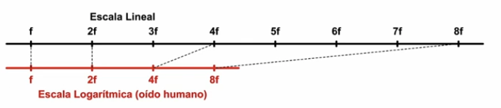
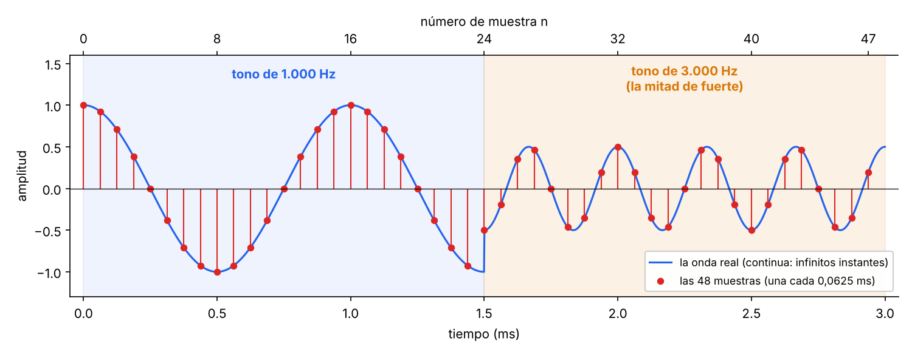
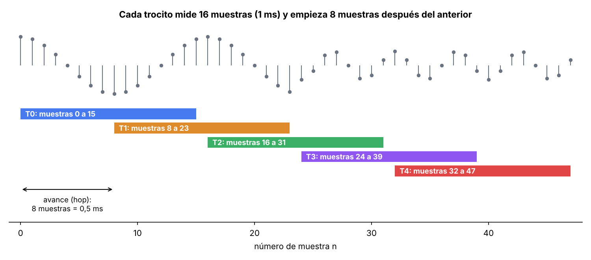
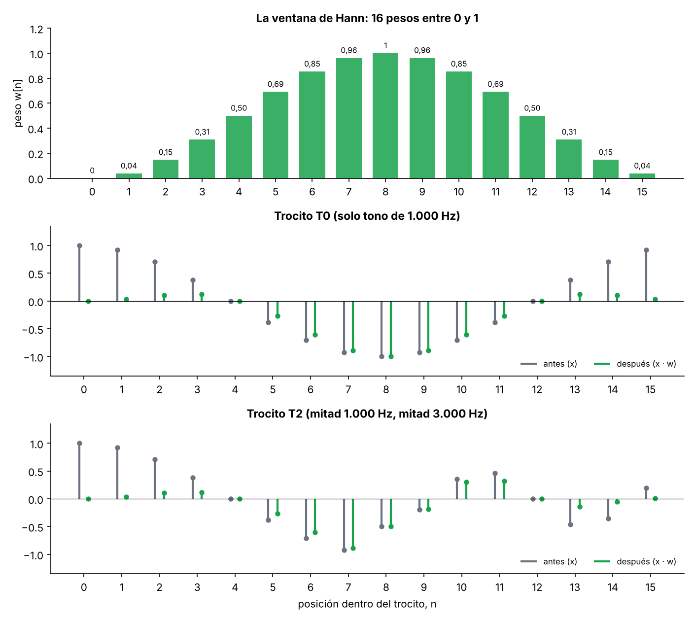
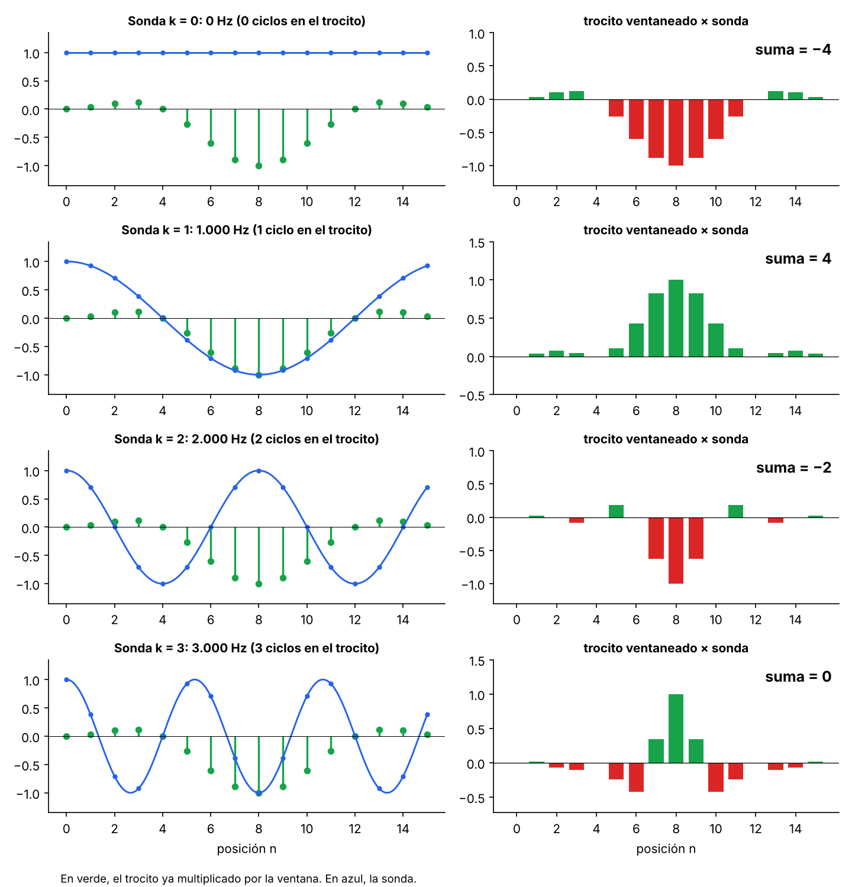
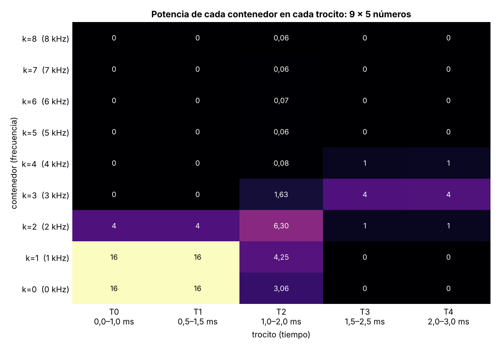
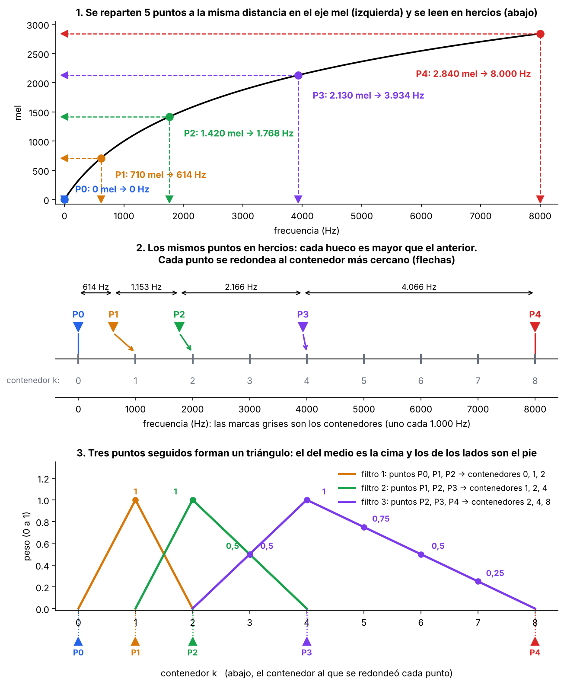
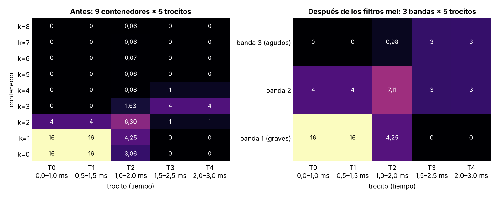
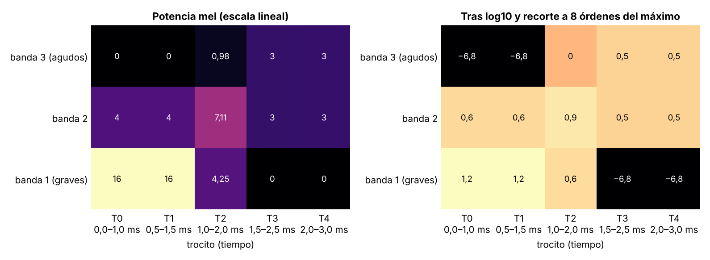
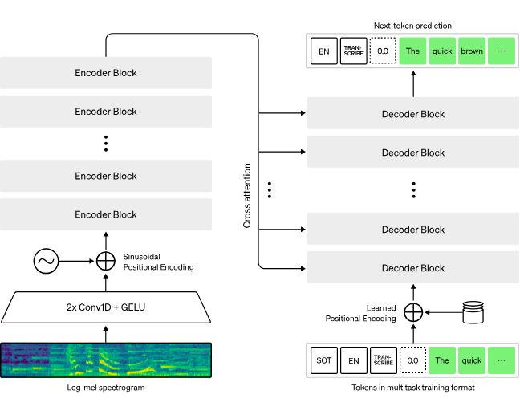

# Whisper4Parkinson
Fine tuned whisper model for parkinson disease's patients with speech difficulties


# Análisis sonido

Por defecto una onda de sonido es una señal continua formada por infinitos valores, lo cual es un problema pues los dispositivos digitales esperan arrays finitos. Es por ello que es necesario convertirlos a valores discretos, es lo que se conoce como representación digital.

Muestrear es el proceso de medir el valor de una señal continua en pasos de tiempo fijos. La frecuencia o ratio de muestreo es el número de muestras tomadas en un segundo. Un ratio comun en el entrenamiento de modelos de voz es de 16kHz, ya que las frecuencias que oye el oído humano están por encima de los 8kHz. La elección del ratio determina la frecuencia más alta que puede ser capturada de la señal. Es lo que se conoce como límite Nyquist y es la mitad del ratio.

Un sonido de 1000 Hz es una onda que sube y baja 1000 veces por segundo, cada subida y bajada es un ciclo, por ejemplo, 4Hz, son 4 máximos y 4 mínimos, sube y baja 4 veces. Para capturar un ciclo es necesario al menos un punto en la parte alta y otro en la baja. Si hay 8000 puntos por segundo, solo se pueden captar 4000 ciclos por segundo, 4Hz, es lo que se conoce como frecuencia de Nyquist: la mitad de la frecuencia de muestreo.

El sonido se forma por cambios de presión a frecuencias oibles por el ser humano. La amplitud describe el nivel de presión en un momento del sonido y se mide en dB. 

La profundidad de bit determina la precisión con la que se guarda cada valor de la muestra (amplitudes). Con 16 bits, la amplitud puede tomar 65.536 valores distintos, con 24 bits, más de 16 millones. Cuanto mayor sea la profundidad de bits, más fielmente se aproximará la representación digital a la onda sonora continua original, dado que para pasar de la onda continua a discreta se tiene que redondear, lo cual introduce un error que suena como una especie de soplido, es el ruido de cuantización. Con 16 bits, se consigue que el ruido sea tan bajo que el oído no lo percibe.

Para ver la representación visual de las amplitudes se puede usar la librería `librosa.display.waveshow`. También se puede visualizar el espectro de frecuencia calculado mediante la transformada de Fourier. Describe las frecuencias individuales que componen la señal y como de fuertes son.

```
import numpy as np

dft_input = array[:4096]

# calculate the DFT
window = np.hanning(len(dft_input))
windowed_input = dft_input * window
dft = np.fft.rfft(windowed_input)

# get the amplitude spectrum in decibels
amplitude = np.abs(dft)
amplitude_db = librosa.amplitude_to_db(amplitude, ref=np.max) # Valores de amplitud a dB

# get the frequency bins
frequency = librosa.fft_frequencies(sr=sampling_rate, n_fft=len(dft_input))

plt.figure().set_figwidth(12)
plt.plot(frequency, amplitude_db)
plt.xlabel("Frequency (Hz)")
plt.ylabel("Amplitude (dB)")
plt.xscale("log")
```

La representación unidimensional del sonido no es la más apropiada para modelos deep learning. Es mejor un preprocesamiento que descomponga la onda en 2 dimensiones: tiempo y frecuencias. Esta forma de representación es el espectrograma. Apila diferentes espectros obtenidos mediante el cálculo de la transformada de Fourier en un trozo de tiempo. Así se puede ver como cambia la frecuencia con el tiempo y permite ver en una sola representación el tiempo, la amplitud y la frecuencia. Utiliza Short Time Fourier Transform. El problema de esta representación es que los humanos perciben frecuencias logarítmicas, y en estas representaciones la frecuencia se plasma linealmente. Una octava es el intervalo musical que separa dos notas cuyas frecuencias guardan relación 2 a 1 (la nota mas aguda vibra al doble de velocidad que la grave). Por ejemplo de Do agudo a grave hay 8 notas. Aunque son notas distintas en altura, el cerebro humano las percibe como similares. La escala lineal sería f-2f-3f-4f-5f-6f-7f-8f. En escala logarítmica esto sería: f-2f-4f-8f. Se consigue que todas las octavas tengan el mismo tamaño. Por ejemplo, entre 100 y 200Hz la diferencia es de 100Hz, un salto pequeño, mientras que entre 4000 y 8000 la diferencia es de 4000Hz, 40 veces mayor, pero el cerebro percibe ese salto igual. Un susurro está en torno a 30 dB y un motor de avión a unos 130 dB. En potencia, esa diferencia es de 10.000 millones de veces. Si el oído fuera lineal, no podríamos oír ambos sin dañarnos ni perder el susurro. Al comprimir con una escala logarítmica, cabe un rango enorme en poco espacio. Mel plasma la relevancia perceptual de las frecuencias.



```
import numpy as np

dft_input = array[:4096]

# calculate the DFT
window = np.hanning(len(dft_input))
windowed_input = dft_input * window
dft = np.fft.rfft(windowed_input)

# get the amplitude spectrum in decibels
amplitude = np.abs(dft)
amplitude_db = librosa.amplitude_to_db(amplitude, ref=np.max)

# get the frequency bins
frequency = librosa.fft_frequencies(sr=sampling_rate, n_fft=len(dft_input))

plt.figure().set_figwidth(12)
plt.plot(frequency, amplitude_db)
plt.xlabel("Frequency (Hz)")
plt.ylabel("Amplitude (dB)")
plt.xscale("log")
```

El espectrograma de Mel cambia el eje de frecuencia teniendo en cuenta que el sistema auditivo humano es más sensible a cambios en baja frecuencia que en alta. La escala mel comprime los agudos y da más espacio a los graves, imitando esa percepción. Así el modelo dedica más detalle a las frecuencias donde está la información de la voz. Por ello los modelos suelen usar esta información. En esta escala, distancias iguales tienen la misma distancia de percepción. Además, está calibrada para que 1000 Hz sean 1000 Mel y se diseña para que pasos iguales en Mel suenen como pasos iguales en tono.


Las fórmulas para convertir Hercios a Mel y vicerbersa son las siguientes. El término $$1 + \frac{f}{700}$$ se usa porque no es logarítmico del todo, a frecuencias menores de 1kHz es casi lineal

$$
m = 2595 \cdot \log_{10}\left(1 + \frac{f}{700}\right)
$$

$$
f = 700 \cdot \left(10^{\frac{m}{2595}} - 1\right)
$$


El proceso para el procesado de la señal continua es el siguiente. La señal medida es una señal continua, con valores infinitos, este tipo de señal no puede ser tratada por los dispositivos digitales, por lo que se digitaliza o se hace discreta. Para ello se usa el muestreo. Por ejemplo, una frecuencia de muestreo de 16kHz toma 16.000 mediciones de la onda en un segundo. Si la onda dura 3 ms, tomará 48 mediciones en ese tiempo. De estas mediciones, se recuperan trocitos (n_fft) cada x tiempo que abarcan un periodo de tiempo, por ejemplo, trocitos de 1 ms (16 muestras) cada 0.5 ms (para que haya solape). Con ello se recuperan 5 trocitos. Como un trozo puede terminar en saltos bruscos que da lugar a frecuencias falsas, se suaviza con la ventana de Hann, que tiene valor 0 en los extremos y 1 en el centro:

$$
w[n] = 0.5 - 0.5 \cdot \cos\left(\frac{2\pi \cdot n}{16}\right)
$$









Tras esto, se aplica Fourier para saber cuanta energía hay en cada frecuencia. Para cada frecuencia se fabrica una onda pura llamada sonda. Se multiplica por cada trocito suavizado y se suman los resultados (las 16 muestras del trocito tras multiplicar). Si el trocito contiene esa frecuencia, casi todos los productos tienen el mismo signo y la suma sale grande. Si no, unos son positivos y otros negativos y la suma se cancela. El número de contenedores lo determina el número de sondas (k=0,1...). Este valor se basa en el límite de Nyquist, pues por encima de la mitad de la frecuencia de muestreo más alta las ondas se repiten y no aportan valor,repiten por la otra mitad lo que ya dan las de abajo (la de k y la de N − k dan los mismos números), así que no se pueden distinguir. El número de contenedores acaba siendo la frecuencia de muestreo más alta (fs/2) y el tamaño del trocito (fs/N), donde N es el número de muestras. Con el ejemplo, como fs/2 es 8000 kHz, se tendrían 9 sondas, desde T0 (0 kHz) a T8.




El valor que se guarda para empezar a construir el espectrograma es la potencia, esto es la suma al cuadrado de la suma de muestras multiplicadas con la sonda tanto para el seno como para el coseno (se usan ambos pues puede estar desplazada y uno compensa al otro): 



A continuación se va a aplicar el filtro de Mel a los 9 contenedores. Como se puede ver todos los contenedores tienen el mismo ancho de 1kHz. El oído no distingue igual en graves que en agudos, así que se agrupan en bandas: estrechas en graves y anchas en agudos. Los estremos son 0kHz y 8kHz (el rango que cubren los contenedores). Se tienen que crear X puntos igualmente separados, donde X es el número de bandas, en este caso se crean 5 (3 + 2). Se convierten a Hz esos puntos y se redondean al contenedor más cercano. Son el centro de las bandas de Mel, con ellos se crean filtros triangulares y llevan asociado un valor, de 0 a 1. Los filtros graves son estrechos y los agudos anchos, y cada uno se solapa a medias con el siguiente: el pico de uno es el final del vecino. El peso de cada contenedor dice cuánto pasa de él: 1 pasa entero, 0 se descarta, 0,5 pasa a la mitad.




| Contenedor $k$ | 0 | 1 | 2 | 3 | 4 | 5 | 6 | 7 | 8 |
| :--- | :---: | :---: | :---: | :---: | :---: | :---: | :---: | :---: | :---: |
| **Banda 1** (puntos 0, 1, 2) | 0 | 1 | 0 | 0 | 0 | 0 | 0 | 0 | 0 |
| **Banda 2** (puntos 1, 2, 3) | 0 | 0 | 1 | 0.5 | 0 | 0 | 0 | 0 | 0 |
| **Banda 3** (puntos 2, 3, 4) | 0 | 0 | 0 | 0.5 | 1 | 0.75 | 0.5 | 0.25 | 0 |


Cada banda es la suma del peso por la potencia sobre los contenedores. Por ejemplo, para T0: $$(0*16) + (1*16) + (0*4) + (0*0) +...$$




Finalmente se convierte a escala logarítmica. Se aplica el logaritmo en base 10, con un mínimo de $$10^{10}$$, porque log10(0) no existe y se haría un reescalado para la red neuronal.


    

Existen varias variantes del espectrograma por lo que hay que ser cuidadoso con cual se ha entrenado cada modelo.

```
S = librosa.feature.melspectrogram(y=array, sr=sampling_rate, n_mels=128, fmax=8000)
S_dB = librosa.power_to_db(S, ref=np.max)

plt.figure().set_figwidth(12)
librosa.display.specshow(S_dB, x_axis="time", y_axis="mel", sr=sampling_rate, fmax=8000)
plt.colorbar()
```

### Griffin-Lim algorithm o vocoder.


# Preprocesamiento

Para convertir una entrada cruda en características de entrada. Whisper en primer lugar trocea la entrada en muestras de longitud fija, por ejemplo, 30 segundos (las que no lleguen a 30 segundos las rellena con 0 al final, que corresponden a silencio, y las que se pasan las trunca a 30 segundos).Hay otros modelos que usan mecanismos de atención. Estos frggmentos los convierte en espectrogramas de Mel-log.

```
from transformers import WhisperFeatureExtractor

feature_extractor = WhisperFeatureExtractor.from_pretrained("openai/whisper-small")

def prepare_dataset(example):
    audio = example["audio"]

    if audio["sampling_rate"] != 16000:
        audio_array = librosa.resample(
            audio["array"], orig_sr=audio["sampling_rate"], target_sr=16000
        )
        audio = {"array": audio_array, "sampling_rate": 16000}

    features = feature_extractor(
        audio["array"], sampling_rate=audio["sampling_rate"], padding=True
    )
    return features

df = df.map(prepare_dataset)

```

Es posible usar el streaming mode para cargar datos progresivamente mientras se itera sobre el dataset, así no hay que descargar todo el dataset que puede ser inmenso, se activa al cargar el dataset con ```load_dataset(streaming=True)``` y ```next(iter(df["train"]))```. 

# Arquitectura transformer
Para tareas de audio, la entrada o salida suele ser audio en lugar de texto. No obstante para TTS la entrada es texto y la salida audio y para STT al revés. Independientemente de la entrada, debe realizarse una conversión a embeddings. Si la entrada es una onda de una dimensión, como es el caso de modelos como HuBERT, la entrada se normaliza a media cero y varianza uno, que permite estandarizar para diferentes amplitudes. Tras esto se convierte en embeddings con una red neuronal convolucional pequeña llamada feature encoder. El problema de estas entradas es que pueden ser muy grandes, por ello se usan espectrogramas. Para Whisper, por ejemplo, estamos hablando de un tamaño para cada segmento de (80, 3000), donde 80 es el número de bandas y 3000 la longitud de la secuencia. Este espetrograma es procesado por una CNN pequeña y genera embeddings.

Para la salida de texto se suele usar una cabeza de modelado de lenguaje que consiste en una capa lineal con softmax. Para generar espectrogramas se usan unas capas convolucionales Post-Net que corrigen el espectrograma generado y corrigen ruido. Además se usa una red Vocoder para convertirlo en la onda final.

En el caso de modelos como Whisper se usan arquitecturas seq2seq:


# Automatic Speech Recognition

